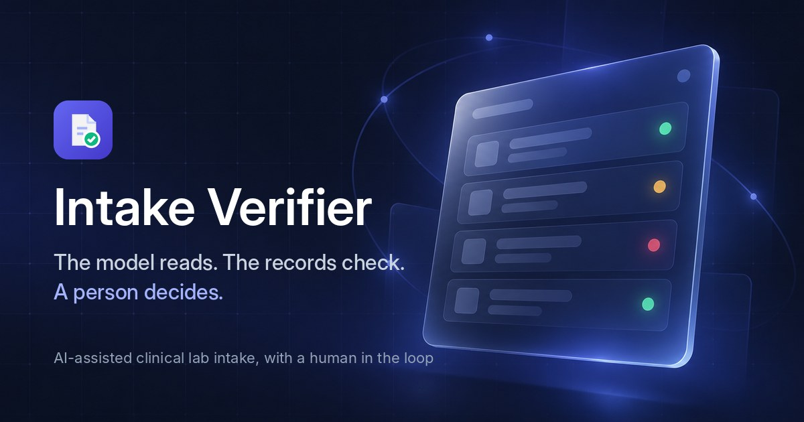
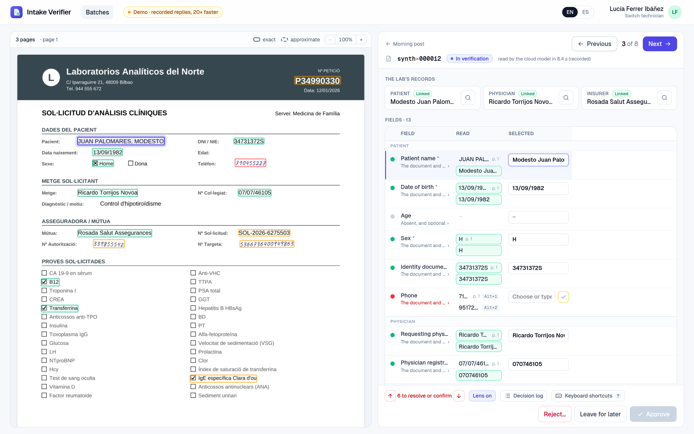
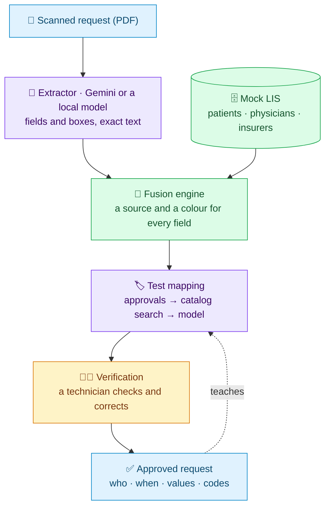
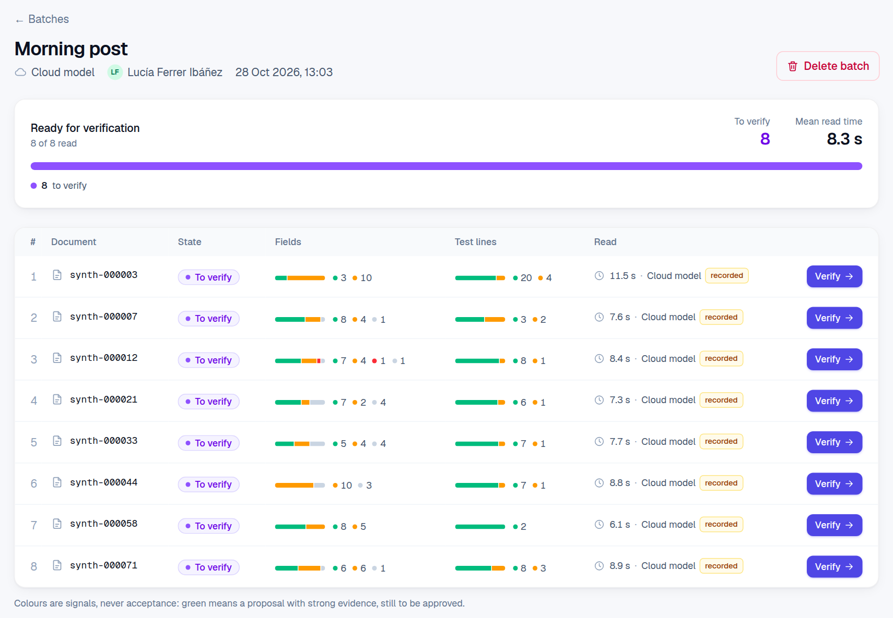

<div align="center">



# 🩺 clinical-intake-verifier

**AI-assisted intake of clinical lab requests, with a human in the loop.**<br>
A request form is scanned, a vision model reads it, and a technician **verifies and approves**
instead of typing it in.

[](https://demos.nicolasbarcelo.dev/verificador-peticiones)
[](https://github.com/ferreret/clinical-intake-verifier/actions/workflows/ci.yml)
[](#%EF%B8%8F-status)
[](LICENSE)


[**Demo**](https://demos.nicolasbarcelo.dev/verificador-peticiones) ·
[**Results**](#-results) ·
[**How it works**](#-how-a-request-goes-through) ·
[**Run it**](#%EF%B8%8F-run-the-app) ·
[**Roadmap**](docs/roadmap.md)

</div>

---

## 💡 The idea

The point is not the extraction: that is a commodity. The point is the engineering stance
around it.

> [!IMPORTANT]
> **The model is not the source of truth. It is one more source, and not the highest-priority one.**

When the model and the system of record disagree, **the model does not win**: the field turns
red and a person decides. Everything in this repository follows from that idea: systematic
evaluation on every change, provenance on every field, and explicit handling of uncertainty.

<p align="center">
  
  <br>
  <sub><b>The verification screen.</b> Every value read has its box on the page; every field its colour, what was read and what the lab's records hold. Nothing counts until <i>Approve</i>.</sub>
</p>

> [!NOTE]
> Portfolio project by **Nicolás Barceló**, rebuilt from scratch from a real clinical
> digitisation problem. All data is synthetic and generated by the project itself: no real
> documents, no real patients, no real organisations.

## 🚀 Try the live demo

**[demos.nicolasbarcelo.dev/verificador-peticiones](https://demos.nicolasbarcelo.dev/verificador-peticiones)**

1. 👤 Pick one of the (invented) technicians.
2. 📥 Put a few of the 200 synthetic requests in a batch, and choose who reads them: the cloud
   model or the local one.
3. 🔎 Verify them: every field with its traffic light and its box on the page, every requested
   test with the lab's codes.
4. ✅ Approve, and see what was recorded: who, when, and exactly which values and codes.

The demo replays readings recorded beforehand, faster than they took: no API key, no cost per
visit, and a sandbox of your own.

## 🚦 The traffic light

| | When | What it means |
|:---:|---|---|
| 🟢 | The document and the lab's records agree, or only the records hold it | Proposed with strong evidence, **still to be approved** |
| 🟠 | Only the document says so | Plausible, the records cannot confirm it: check it |
| 🔴 | **The document and the records disagree**, or a required field is missing | **A person decides** |
| ⚪ | Absent, and optional | Nothing to do |

> [!TIP]
> **A colour is a signal, never an acceptance.** Nothing, neither fields nor tests, counts
> until the technician approves the request: an explicit act that records who, when, and the
> exact values and codes.

## 📊 Results

Measured end to end on **200 synthetic requests** (multipage, half of them scanned, some
handwriting, three templates, some in Catalan), with the chain as the product runs it. The
numbers in bold are the ones that must stay at zero: they would let an error through unnoticed.

| | ☁️ Gemini Flash | 💻 Qwen3.6-35B-A3B, local |
|---|:---:|:---:|
| Field precision / recall | **99.8%** / 99.8% | **99.5%** / 99.6% |
| Values invented (read where the form has none) | 0 | 3 |
| Boxes located (IoU ≥ 0.5) | 99.4% | 84.4% by the page's OCR, the rest approximate |
| 🛡️ Documents linked to the wrong patient | **0** ✅ | **0** ✅ |
| 🛡️ Reading errors shown green | **0** ✅ | **0** ✅ |
| 🛡️ Test lines proposed green with wrong codes | **0** ✅ | **0** ✅ |
| Test lines left for the technician to code | 1.5% | 1.5% |
| Time per document | ~9 s | ~80 s, integrated GPU (Radeon 890M) |

Every reading error ended **orange or red, never green**: the records disagreed with it, or
could not confirm it.

> [!TIP]
> **Measured on every commit.** [CI](.github/workflows/ci.yml) regenerates the 200 requests
> from their seed, scores the recorded readings of both models and fuses them with the mock
> LIS, and fails if any measure falls below its floor in
> [`.github/evaluation/floor.json`](.github/evaluation/floor.json): a change to the code that
> judges the readings cannot quietly make the numbers above worse.

> [!CAUTION]
> Synthetic data flatters any system: its wording is cleaner than real forms. These numbers
> show that the method works and is measured, not what it would score on real requests.
> Definitions and every run are in [docs/evaluation.md](docs/evaluation.md) and
> [docs/roadmap.md](docs/roadmap.md).

## 🧭 How a request goes through



- 🥇 **Sources, in order of priority:** the lab's records, then what was read, then defaults.
- 🧾 **Every field carries its provenance:** what was read and where on the page, what the
  records hold, where the proposed value came from, and who changed it. A **decision log**
  explains every colour, step by step.
- 🏷️ **Test mapping learns from approvals only.** Each insurer words tests its own way. A line
  is proposed from what technicians approved before for that insurer (🟢 after two approvals),
  else from a trigram search of the 726-test catalog (🟠), and only the lines still red go to a
  model, **which may choose only among the search's candidates**.
- ✍️ **Approving is one recorded transaction:** the decision, the request registered in the
  mock LIS, and what the mapping memory learns. An empty required field, a value out of its
  field's form, or an orange or red item not confirmed blocks it.

<p align="center">
  
  <br>
  <sub><b>A batch,</b> read and waiting for verification: fields and test lines counted by colour, and how long each reading took.</sub>
</p>

The workflow and the screens are described in [docs/workflow.md](docs/workflow.md).

## 🗺️ Status

| Phase | Scope | State |
|:---:|---|:---:|
| **F1** | 🧪 Synthetic request generator with golden ground truth | ✅ done |
| **F2** | 🤖 Extractor: Gemini Flash, or an open-weight model run locally, with boxes | ✅ done |
| **F3** | 📏 Evaluation harness against the golden sample | ✅ done |
| **F4** | 🔀 Mock LIS, fusion engine and test mapping to lab codes | ✅ done, measured end to end |
| **F5** | 👩‍🔬 Batches, processing queue and the verification screen, with explicit approval | ✅ done |
| **F6** | 🚀 Public demo on a self-hosted Dokploy, this README, and CI | ✅ live |

> [!NOTE]
> **F3 comes before the UI on purpose.** Without per-field metrics there is no way to know
> whether a prompt change helped or hurt, and that is exactly what this project wants to show.
> Current state, open proposals and next steps: [docs/roadmap.md](docs/roadmap.md).

## ▶️ Run the app

Requirements: **Node 22**. From `web/`: `npm install`, then `npm run dev`, and open
<http://localhost:3000>. Two modes, chosen by `APP_MODE` in `web/.env.local`:

### 🎞️ Replay (default): the public demo, no key needed

Recorded readings of the 200 bundled requests, and a sandbox per visitor. The data, all of it
synthetic, is in the release
[`demo-data-2026-10-27`](https://github.com/ferreret/clinical-intake-verifier/releases/tag/demo-data-2026-10-27):

```bash
mkdir -p data && gh release download demo-data-2026-10-27 --dir data
tar -xzf data/demo-data-2026-10-27.tar.gz -C data
```

and in `web/.env.local`:

```ini
DEMO_DOCUMENTS=../data/demo/documents
REPLAY_GEMINI_RUN=../data/demo/runs/gemini
REPLAY_LOCAL_RUN=../data/demo/runs/local
LIS_TEMPLATE=../data/demo/lis.sqlite
REPLAY_MAPPING=../data/demo/mapping.json
```

### ⚡ Live: the models for real

The extractor is called live (`GEMINI_API_KEY`, or a local model behind any OpenAI-compatible
server such as LM Studio), and PDFs can be uploaded. Uploads are kept outside the repository,
since they may be real requests.

🐳 Deploying it as a container: [docs/deploy.md](docs/deploy.md).

## 🧰 Toolkit

The pieces can be run one by one: generate data, extract, evaluate, fuse, map.

<details>
<summary><b>🧪 Generate synthetic requests</b> (Python, uv)</summary>

<br>

Requirements: Python 3.12 and [uv](https://docs.astral.sh/uv/).

```bash
cd synth
uv sync
uv run intake-synth generate --n 50 --seed 42
```

This writes 50 PDFs, 50 golden JSON files, a `manifest.json`, the lab's test catalog
(`catalog.json`) and the lab's own records of patients, physicians and insurers (`lis.json`,
the mock LIS) into `data/synth/seed-42/`. Same seed, same bytes on the same platform; on
another operating system the content is the same but the PDF bytes may differ (see
[docs/golden-format.md](docs/golden-format.md#reproducibility)). Useful options:

```
--scan-ratio 0.5          fraction passed through the scanner simulation (raster, skew, blur, grain, JPEG)
--handwriting-ratio 0.4   fraction with some fields written in a handwriting font
--templates lab-classic,insurer-form,hospital-compact
--only-index 17           regenerate one document, byte-identical to the batch
--out <dir>               output directory (default data/synth/seed-<seed>)
```

Check a golden visually, or validate a whole directory, and run the tests:

```bash
uv run intake-synth debug-boxes ../data/synth/seed-42/synth-000003.json
uv run intake-synth validate ../data/synth/seed-42
uv run pytest
```

</details>

<details>
<summary><b>🤖 Run the extractor</b> (Next.js)</summary>

<br>

Requirements: Node 22, and a Gemini API key or a local model.

```bash
cd web
npm install
cp .env.example .env.local        # then put your key in GEMINI_API_KEY
npm run dev
```

In live mode (`APP_MODE=live` in `.env.local`), `POST /api/extract` takes a multipart form
with a `file` field and returns a prediction:

```bash
curl -F "file=@../data/synth/seed-42/synth-000003.pdf" http://localhost:3000/api/extract
```

To run it over a whole batch without the server:

```bash
npm run extract -- --in ../data/synth/seed-42 --limit 20
```

This writes one `<id>.pred.json` per document and a `run.json` into `data/runs/<run-id>/`,
reading only the PDFs. Running it again skips documents already predicted with the same model
and prompt version, so a prompt change costs only what changed. Compare a prediction with its
golden visually, or validate a run:

```bash
cd ../synth
uv run intake-synth debug-boxes ../data/synth/seed-42/synth-000003.json --prediction ../data/runs/<run-id>/synth-000003.pred.json
uv run intake-synth validate ../data/runs/<run-id>
```

Tests, types and lint: `npm test && npm run typecheck && npm run lint`.

</details>

<details>
<summary><b>📏 Evaluate a run</b></summary>

<br>

```bash
cd synth
uv run intake-synth evaluate ../data/runs/<run-id>
```

This scores every prediction against its golden and writes `report.json` and `report.md` into
`data/runs/<run-id>/eval/`:

```
eval 20261022-140331-gemini-3.8-flash-p2 vs data/synth/seed-42
  documents : 5 evaluated, 0 failed, 0 rejected, 195 of the source not in this run
  fields    : precision 100.0%  recall 100.0%  invented 0/19   46 correct, 0 wrong, 0 missed
  tests     : P 100.0%  R 100.0%  F1 100.0%  exact list 5/5
  boxes     : located 92/93 at IoU>=0.5, median 0.74
  warnings  : 0
  cost      : 8.8 s/doc, 2479 in / 1044 out tokens per doc
  worst     : none
```

Every field of every document is correct, wrong, missed, a correct null or **invented**. The
report gives precision, recall and invention rate per field, test-list metrics, box
localisation, warnings, failures by error code, and the same metrics sliced by scan, template,
page count and handwriting, ending with the full list of mismatches. A failed API call is
counted as a failure, not as a worse model. Definitions: [docs/evaluation.md](docs/evaluation.md).

To see what a change did, compare with an older run over the same goldens; the report adds the
change in every metric and the fields that were fixed and, more importantly, the ones that broke:

```bash
uv run intake-synth evaluate ../data/runs/<new-run> --baseline ../data/runs/<old-run>
```

</details>

<details>
<summary><b>🔀 Fuse with the LIS</b></summary>

<br>

The fusion engine sets each document against the lab's own records and gives every field a
traffic light. Load the mock LIS, fuse, and score the result against each document's scenario:

```bash
npm --prefix web run seed-lis -- ../data/synth/seed-42
npm --prefix web run fuse -- --golden ../data/synth/seed-42
cd synth && uv run intake-synth evaluate-fusion ../data/fusion/<fusion-id>
```

Without `--run`, every golden stands in for a perfect extraction; add
`--run ../data/runs/<run-id>` to fuse a real one. The two numbers that must stay at zero are
documents linked to the wrong patient and wrong values shown green. See
[docs/evaluation.md](docs/evaluation.md#fusion).

</details>

<details>
<summary><b>🏷️ Map tests to lab codes</b></summary>

<br>

Each requested line is mapped to the lab's codes: from what technicians approved before for
that insurer, then from a search of the catalog. A simulated technician replays a dataset in
order, approving and correcting, so the memory of approvals fills up as it would in use:

```bash
uv --directory synth run intake-synth generate --n 1000 --seed 42 --out ../data/synth/seed-42-n1000
npm --prefix web run map-simulate -- --dataset ../data/synth/seed-42-n1000
cd synth && uv run intake-synth evaluate-mapping ../data/mapping/<mapping-id>
```

The report is the learning curve: for each insurer, the share of lines proposed green and the
share the technician had to correct, from its first request to its hundredth. Green lines still
wait for the technician's approval; the number that must stay at zero is green lines with the
wrong codes. See [docs/evaluation.md](docs/evaluation.md#test-mapping).

</details>

## 🔬 Under the hood

<details>
<summary><b>🤖 How the extractor works</b></summary>

<br>

**Two layers and a boundary.** The model is asked for a flat JSON in its own conventions (boxes
as `[ymin, xmin, ymax, xmax]` on a 0–1000 scale), with the field list and the prompt generated
from `schema/fields.json`. A boundary converts that into the prediction the rest of the system
consumes, with the same field keys and the same box shape as the golden, so that evaluation
needs no adapters.

- **It validates and annotates, but never repairs:** a date that does not match its pattern
  stays as the model wrote it, flagged with a warning, for the fusion engine and the operator
  to decide. Its one rewrite is mechanical and flagged too: a title the model left in front of
  the physician's name is removed.
- **Garbled text is asked for again, never patched:** accented letters come back, now and then,
  as `Est\tevez` or `Ferr&#225;ndiz`; that is detected and flagged, and the document is read
  again.
- **The local model sees page images**, and its boxes are placed by the page's own OCR where
  it finds the value; where it does not, the model's box is kept and drawn as approximate.
- **Every prediction records model, prompt version and input mode,** so two runs are only
  compared when they were produced the same way.

The contract is specified in [docs/extractor-contract.md](docs/extractor-contract.md) and
enforced by [`schema/prediction.schema.json`](schema/prediction.schema.json) on both sides.

</details>

<details>
<summary><b>🧪 What the generator produces</b></summary>

<br>

- 📚 **Multipage scans, the way they really arrive.** The request form itself (three templates,
  with long test lists continuing on a second page) plus companion sheets in random order: the
  insurer's authorisation letter, a photocopy of the insurance and identity cards, an informed
  consent filled in by hand, a fax cover sheet, the blank back of a duplex scan, or the same
  form scanned twice. The request is not always page 1, any field may sit on any page, and
  values repeat across sheets.
- 🖨️ **Three templates** of Spanish lab request forms: a private laboratory form with a
  checkbox test list, an insurer authorisation form with grouped profiles, and a dense hospital
  form with a patient sticker. Formats vary, optional fields drop out, some fields are
  handwritten, and there are distractors: record numbers with their own barcode, unticked
  pre-printed tests, an identity card that prints F for *mujer*. Half the output goes through a
  scanner simulation with per-page skew.
- 🗣️ **Insurers write tests their own way, some in Catalan.** Tests come from a synthetic
  catalog of 726 coded tests, and each insurer prints them in its own wording ("GLU (SUERO)",
  "S-Glucosa", "Glucèmia").
- 🗄️ **A mock LIS to check documents against.** Each document has a scenario: everything
  agrees, the phone changed since, the form has a typo, the patient is new, or another patient
  has the same name.

✨ **The golden sample comes for free.** The generator knows exactly what it drew, so every
document comes with its ground truth: the value of each field, the verbatim printed string, the
page and box of its primary occurrence, every other place it appears, and whether it was printed
or handwritten. That is what makes evaluation runnable on every commit. Format:
[docs/golden-format.md](docs/golden-format.md).

</details>

<details>
<summary><b>📋 Fields (v1)</b></summary>

<br>

`Paciente` · `FechaNacimiento` · `Edad` · `Sexo` · `DocumentoIdentidad` · `Telefono` ·
`NombreMedico` · `NumeroColegiado` · `NumeroPeticion` · `NombreMutua` ·
`NumeroSolicitudMutua` · `NumeroAutorizacion` · `NumeroTarjeta` · `tests[]`

Names, types, whether a field is mandatory, its form and how it is compared are defined once in
[`schema/fields.json`](schema/fields.json) and read by both the Python package and the web app.

</details>

## 📁 Repository layout

| | Folder | What it holds |
|:---:|---|---|
| 🧩 | [`schema/`](schema) | The single source of truth: field configuration, golden and prediction JSON Schemas |
| 🐍 | [`synth/`](synth) | Python package (uv): the generator (F1) and the evaluation harness (F3) |
| ⚛️ | [`web/`](web) | Next.js app: extractor, mock LIS, fusion, test mapping, batches and verification |
| 📚 | [`docs/`](docs) | Design notes: golden format, extractor contract, evaluation, workflow, deploy, roadmap |
| 🗃️ | `data/` | Generated documents, runs and demo data: git-ignored, regenerated with one command |

> [!WARNING]
> Real documents never live inside the repository tree. As a second line of defence,
> `.gitignore` excludes `/data/`, every PDF, image and document format, every `.env` file but
> the examples, and SQLite files.

## ⚙️ Configuration

The repository runs without credentials except a Gemini API key for the extractor, and the
replay demo needs none. See [`web/.env.example`](web/.env.example) for that key, the local
model's address (`LOCAL_LLM_URL`, any OpenAI-compatible server such as LM Studio) and the
optional settings. The Python package needs none; `INTAKE_SCHEMA_DIR` and `INTAKE_FONTS_DIR`
can override where it looks for the shared schema and the handwriting fonts.

## 📄 Licence

MIT. Handwriting fonts in `synth/assets/fonts` are under the SIL Open Font License (see the
`OFL-*.txt` files next to them).

<div align="center">

---

<sub>Built with care by <b>Nicolás Barceló</b> · <i>The model reads. The records check. A person decides.</i></sub>

</div>
